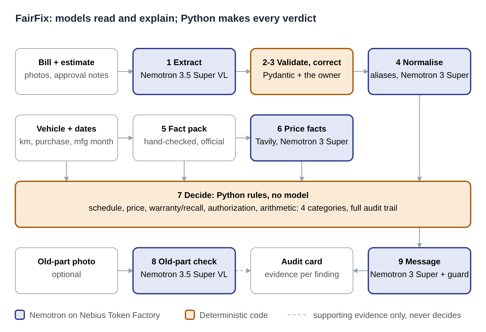

# FairFix

**A second opinion on your vehicle service bill, before you pay.**

Photograph the service bill and the estimate. FairFix reads every line, checks it against the official service schedule, comparable part prices, warranty and recall information and your estimate, and drafts a polite, neutral question for the service advisor. Every result shows the rule and the evidence behind it. When FairFix can't verify something, it says so instead of guessing.

Built for the Nebius x NVIDIA Global AI Hackathon (Best Apps & Agents track) with NVIDIA Nemotron models on Nebius Token Factory. Licence: MIT.

> Live demo: _add URL_ · Demo video: _add YouTube URL_

## The problem

At the billing counter you have about ten minutes, the workshop has your keys, and the bill is full of codes you can't evaluate. Owners rarely know which lines are worth asking about: an item that isn't due yet, a price far above comparable listings, a repair that might be covered by a recall, or work that wasn't on the estimate. FairFix gives them that list, with evidence, and the words to ask.

## How it works: models read, code decides



| # | Step | Done by | Notes |
| --- | --- | --- | --- |
| 1 | Extract | **Nemotron 3.5 Super VL** (vision) | Reads each bill/estimate page into fields exactly as printed. Never computes or corrects. Personal data is dropped by prompt, by schema and by pattern redaction. |
| 2 | Validate | Python + Pydantic | Schema checks and bill-aware arithmetic. Mismatches are flagged, never silently fixed. |
| 3 | Correct | The owner | Correction screen. Every changed value is marked *user-corrected*; the original reading is kept. |
| 4 | Normalise | Alias table, then **Nemotron 3 Super** | Maps each line to one of ~40 standard jobs. Below 0.7 confidence it's *unrecognised*: kept, never guessed or dropped. |
| 5 | Fact pack | Hand-checked JSON | Official schedule, warranty and recall facts per vehicle, each with URL, verbatim excerpt and date checked. |
| 6 | Price facts | **Tavily** search, then **Nemotron 3 Super** | Reads full listing pages (not snippets) from credible sellers; keeps a listing only if its verbatim excerpt is on the page and contains the price. |
| 7 | Decide | `app/rules.py`, no model | Five checks per line, four result categories, full audit trail. |
| 8 | Old-part photo | **Nemotron 3.5 Super VL** | Optional. *Looks worn / Looks fine / Cannot determine*, shown as a photo observation only. It never changes a result. |
| 9 | Message | **Nemotron 3 Super** | Rewrites a deterministic draft in English or Hindi. Any accusatory wording sends it back to the template. |

### The four result categories

Each means the same thing for every check:

- **Supported by evidence**: a rule passed on verified inputs and a sufficient source.
- **Needs confirmation**: a discrepancy worth asking about. Never stated as wrongdoing.
- **Unable to verify**: inputs or sources missing, conflicting or too weak. The reason is shown.
- **Not applicable**: the check doesn't apply to this line.

### The five checks

| Check | Rule (see `app/rules.py`) |
| --- | --- |
| Schedule | Official interval for this model, variant and fuel. Km and months tested independently ("whichever comes first" by default). Measured from the last replacement the owner reports; if unknown, only a match to a scheduled milestone can support the line, otherwise *Unable to verify*. Wear items (brakes, clutch) are condition-based: *Not applicable*. Add-ons absent from a complete official schedule: *Needs confirmation*. |
| Price | Parts vs parts, labour vs labour. Same part number, or same job and grade. GST normalised using each listing's own rate. At least **3** comparables from at least **2** credible sellers, under **90** days old, not out of stock. Flagged only when more than **15%** above the highest comparable, with every listing and the calculation shown. Otherwise *Unable to verify price fairly*. All thresholds configurable. |
| Warranty or recall | Recall: model + variant + manufacturing period from SIAM or the manufacturer, giving at most a *Potential recall match: verify eligibility using your chassis number*. Warranty: needs purchase or registration date, odometer and the warranty terms. FairFix never says "free" or "covered". |
| Authorization | Estimate + later approvals the owner records in writing + final bill. Unmatched lines: *Not present in the uploaded estimate: confirm authorization*. |
| Arithmetic | Uses the bill's own structure: subtotal, discount before or after tax, tax lines, tax-inclusive or not, round-off. ±₹1 per line, ±₹2 on totals. Ambiguous tax or discount treatment gives *Unable to verify*, not a false mismatch. |

**Sources.** Only official, human-verified sources (manufacturer, SIAM) can decide schedule, warranty and recall results. Secondary sources can only point the owner to official verification.

## NVIDIA models and Nebius Token Factory

| Role | Model | Why |
| --- | --- | --- |
| Reading bills and part photos | `nvidia/Nemotron-3.5-Super-VL` | The NVIDIA vision model with a public Token Factory endpoint |
| Line mapping, price extraction, messages | `nvidia/nemotron-3-super-120b-a12b` | Good structured output at low cost |
| (optional) messages | `nvidia/Nemotron-3-Ultra-550b-a55b` | Only if the eval shows a clear gain. _Fill in the result._ |

All calls go through one OpenAI-compatible client (`app/llm.py`), so switching a model is one line in `.env`. Every call is logged (model, latency, tokens, outcome; never content) to `logs/calls.jsonl`.

Measured in the live evaluation: a full audit, including reading the photo, takes a median of **3.8 s** (slowest 6.8 s) with price search off. All 35 model calls succeeded on the first try. With live part-price search on, a full check of a 6-line bill took 6.1 s in the live check (`check_live.bat`): searches and page reads run in parallel, and only the 6 most relevant pages per part are read. Busy responses from the provider (429/5xx/529) are retried after 2 s and 5 s.

Token Factory specifics we hit: Nemotron 3 Super is a reasoning model and, with a small token budget, can spend it all thinking and return an empty answer. FairFix turns thinking off for these extraction calls (`chat_template_kwargs.enable_thinking=false`, falling back if the endpoint rejects it) and treats an empty reply as an error. _Add tokens per audit from `logs/calls.jsonl` and anything else Token Factory made easier._

## Run it

On Windows: double-click `run_app.bat` to start FairFix at http://localhost:8765, and `check_live.bat` to test every setting, key, model call and the access controls (report in `logs/check_report.md`).

```bash
git clone <repo> && cd fairfix
python -m venv .venv && source .venv/bin/activate
pip install -r requirements.txt
cp .env.example .env          # add NEBIUS_API_KEY and TAVILY_API_KEY
python -m scripts.check_live  # checks every setting, key, model call, endpoint and the account flow
uvicorn app.main:app --reload
# open http://localhost:8000
```

Without keys the app still runs: the samples work, and you can type a bill in by hand. Photo reading, line mapping by model, price search and model-drafted messages switch on when keys are present.

Tests and evaluation:

```bash
pytest -q                     # rules, API, stubbed model paths
python -m eval.run_eval       # writes eval/results.md; exits 1 if the release gate fails
python -m eval.run_eval --models --extract   # with real model calls and photo extraction
```

## Deploy for free (Render + Neon)

The app runs on a free Render web service. Accounts live in a free Neon Postgres database, because a free Render instance's disk is wiped on every restart.

1. **Neon** (free, no card): create a project at [neon.com](https://neon.com), region Singapore or Mumbai. Copy the connection string (`postgresql://…?sslmode=require`).
2. **Render** (free): New → Blueprint → pick this GitHub repo. `render.yaml` sets everything up. When asked, paste `NEBIUS_API_KEY`, `TAVILY_API_KEY` and `DATABASE_URL` (the Neon string). Leave `SIGNUP_CODES` empty for open sign-up, or set one to limit sign-ups to people you give it to.
3. Wait for the deploy, then open the `.onrender.com` URL.

Free-tier behaviour: the service sleeps after 15 minutes without visitors and the next visit takes about a minute to wake it. Neon pauses after 5 minutes idle and wakes in under a second. Keys stay in Render's environment settings, never in the repo.

## Supported vehicles

Supported means a **verified** fact pack in `facts/`. Today:

| Vehicle | Status |
| --- | --- |
| FairFix Sample Scooter | Fictional, for demos and tests only. Every fact is labelled FICTIONAL. Hide with `ALLOW_FICTIONAL_SAMPLE=0`. |
| Honda Activa | Template: _fill and verify_ |
| Maruti Suzuki Swift | Template: _fill and verify_ |

Every other vehicle gets a **partial audit**: arithmetic and authorization run; schedule, price and coverage show *Unable to verify*.

To add a vehicle: `python scripts/build_fact_pack.py <id> "<name>"` collects candidate facts with verbatim excerpts into `facts/candidates/`. Open each source, confirm it yourself, copy it into `facts/<id>.json` with `source_rank: 1` (manufacturer or SIAM only) and `verified_by_human: true`, then set the pack's `status` to `verified`.

## Evaluation

The release gate is **zero unsupported flags** (a *Needs confirmation* where the expected answer differs) and **zero accusatory wording**. `eval/results.md` reports raw counts, lists every wrong verdict for manual inspection, and breaks model calls down per step.

**Test set.** 12 mock bills, 0 real so far: 4 simple samples plus 8 deliberately hard ones generated by `scripts/make_hard_bills.py`. The hard ones are a two-page invoice, a handwritten extra line with the printed total crossed out, a faded thermal receipt with shop codes, Hindi item names, a bill that doesn't add up, extra items not on the estimate, a crowded dealer GST invoice, and a dark photo with a stain hiding one amount. All are from fictional workshops and stamped SAMPLE, and each prints a fake name, phone and registration number so the evaluation can check they are removed. Each has a hand-written answer key.

**Two tracks.** *After correction* audits the correct readings (what the owner sees after the correction screen). *Straight from the photo* audits exactly what Nemotron read, before any correction.

**Live results** with Nemotron 3.5 Super VL reading the photos and Nemotron 3 Super mapping lines and writing messages (`python -m eval.run_eval --models --extract`, 28 Oct 2026):

| Measure | First run | After fixes |
| --- | --- | --- |
| Fields read correctly from photos (lines, amounts, quantities, part numbers, totals, GST basis, personal data removed) | 163 of 172 (95%) | 166 of 172 (97%) |
| Bill-level arithmetic, straight from the photo | 14 of 20 | 18 of 20 |
| Flags from the photo that correction would remove | 5 | 2 |
| Personal data kept after extraction | 1 | 0 |
| Unsupported flags after correction (release gate) | 0 | 0 |
| Accusatory wording (release gate) | 0 | 0 |
| Model calls OK on the first try | 36 of 36 | 35 of 35 |

What the first run taught us, and what changed: crossed-out values were being read as a subtotal, tax lines printed under the total were read as the total, "GST INCLUDED" wasn't recognised, a customer's name survived in a free-text note, and taxable-value subtotals on dealer invoices tripped the arithmetic check. Fixed with clearer extraction rules, a name filter on notes, and an arithmetic rule that understands taxable-value subtotals. The full before and after are in `eval/results_before_fixes.md` and `eval/results.md`.

What still goes wrong, deliberately not tuned away: Nemotron misreads faded thermal digits (340 as 348) and shifts a value into a stained row. In both cases FairFix's own arithmetic and the correction-screen hints point the owner at the problem. Asking the model to make totals add up would teach it to invent numbers.

**Honest limits.** These are 12 bills we made ourselves, and the line-mapping table was improved using them, so the numbers are optimistic. They show the pipeline works end to end and fails safely; they are not evidence of real-world accuracy. Real bills are next.

## Privacy

- Bill data lives only for the length of a request: no bills, extracted fields or results are stored, cached or logged.
- Only public data is cached (part-price lookups, fact packs).
- Logs hold model, step, latency, tokens and outcome only. Errors log the error type only.
- Bill photos are sent to an AI model hosted by Nebius to be read. See Nebius's data terms for their retention.
- The VIN or chassis number never reaches FairFix's server. It stays in the browser and is copied only if the owner chooses to open the manufacturer's recall lookup, after a notice that submitting it there shares it with the manufacturer.
- API keys live in backend environment variables only.
- Accounts hold an email address and a scrypt password hash, in `data/users.sqlite` (not in git). Bills, photos and results are never linked to an account.

## Accounts and abuse protection

- **Open to everyone:** the sample bills, the dashboard (`/dashboard.html`) and the template message.
- **Needs an account:** reading photos (`/api/extract`), running checks (`/api/audit`) and model-drafted messages, because these spend model credits. Anyone can create an account with an email and a password (or only people with an invite code, if `SIGNUP_CODES` is set).
- **Passwords:** at least 8 characters, common and email-based passwords refused, hashed with scrypt (N=2^15, r=8, p=1, random salt). A failed sign-in says only "Email or password is incorrect", and unknown emails take the same time to check.
- **Sessions:** a random token in one `ff_session` cookie (HttpOnly, SameSite=Lax, Secure over HTTPS) for `SESSION_DAYS`. The server keeps only its SHA-256 hash, so signing out ends the session even if the cookie was copied.
- **Limits:** per account (`RATE_READ_PER_HOUR`, `RATE_AUDIT_PER_HOUR`), per IP (`RATE_IP_PER_HOUR`), failed sign-ins (`LOGIN_ATTEMPTS` per 15 minutes) and new accounts (`SIGNUPS_PER_HOUR`). Over a limit returns 429 with `Retry-After`.
- **Delete account:** signed-in users can delete their account (password confirmation). Email, password hash and sessions are removed.
- **Headers:** a strict Content-Security-Policy (scripts from this site only, no framing), `nosniff`, `no-referrer`, and `no-store` on API responses. Cross-site requests carrying the cookie are refused.
- Not yet: password reset by email (there is no email sending). `AUTH_REQUIRED=0` turns sign-in off for tests and offline work.

## Limitations

- Coverage is only as good as the fact packs; unsupported vehicles get partial audits.
- Price checks depend on listings being findable for the exact part and grade; many lines will honestly show *Unable to verify price fairly*.
- No sound or video diagnosis: Token Factory serves no audio model, and FairFix judges the bill, not the vehicle.
- Approvals after the estimate are written notes only; screenshots aren't supported yet.
- A photo of a removed part is never proof that a replacement was or wasn't needed.

## Feedback on Nebius and NVIDIA tools

_Write this as you build: what worked, what was hard (exact errors, doc pages), what you'd want next._

## Built during the hackathon

FairFix was started on 27 October 2026, within the submission period.

## If you still disagree

Ask for the job card and the old parts before paying. The National Consumer Helpline (1915, consumerhelpline.gov.in) can advise. FairFix is a second opinion from public information, not a mechanic's inspection or legal advice.
